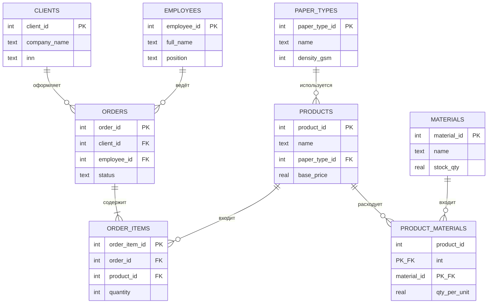

# Отчёт

**Титов Роман**, группа 3ИП-12-24  
Предметная область: **типография**  
СУБД: SQLite

## 1. Описание предметной области

Типография «Печатный двор» печатает полиграфию и широкоформат для юридических лиц и ИП. Клиент оформляет заказ через менеджера. В заказе одна или несколько позиций (вид изделия, тираж, цветность). Каждое изделие печатается на определённом типе бумаги и расходует материалы (краски CMYK, плёнка, скобы).

## 2. Сущности и атрибуты

### clients
| Атрибут | Тип | Смысл |
|---|---|---|
| client_id | INTEGER PK | Код клиента |
| company_name | TEXT | Название |
| contact_person | TEXT | Контактное лицо |
| phone | TEXT | Телефон |
| email | TEXT | Почта |
| inn | TEXT UNIQUE | ИНН |
| address | TEXT | Адрес |

### employees
| Атрибут | Тип | Смысл |
|---|---|---|
| employee_id | INTEGER PK | Код сотрудника |
| full_name | TEXT | ФИО |
| position | TEXT | Должность |
| phone | TEXT | Телефон |
| hire_date | TEXT | Дата приёма |

### paper_types
| Атрибут | Тип | Смысл |
|---|---|---|
| paper_type_id | INTEGER PK | Код бумаги |
| name | TEXT UNIQUE | Название |
| density_gsm | INTEGER | Плотность, г/м² |
| format | TEXT | Формат листа |
| price_per_sheet | REAL | Цена листа |

### products
| Атрибут | Тип | Смысл |
|---|---|---|
| product_id | INTEGER PK | Код продукции |
| name | TEXT | Название |
| category | TEXT | Категория |
| paper_type_id | INTEGER FK | Бумага |
| production_time_hours | INTEGER | Срок изготовления, ч |
| base_price | REAL | Базовая цена |

### materials
| Атрибут | Тип | Смысл |
|---|---|---|
| material_id | INTEGER PK | Код материала |
| name | TEXT | Название |
| unit | TEXT | Единица |
| stock_qty | REAL | Остаток |
| min_stock | REAL | Мин. остаток |
| unit_price | REAL | Цена единицы |

### product_materials
| Атрибут | Тип | Смысл |
|---|---|---|
| product_id | INTEGER FK | Продукция |
| material_id | INTEGER FK | Материал |
| qty_per_unit | REAL | Норма на 1 изделие |
| PK | (product_id, material_id) | Составной ключ |

### orders
| Атрибут | Тип | Смысл |
|---|---|---|
| order_id | INTEGER PK | Номер заказа |
| client_id | INTEGER FK | Клиент |
| employee_id | INTEGER FK | Менеджер |
| order_date | TEXT | Дата заказа |
| due_date | TEXT | Срок |
| status | TEXT | новый / в печати / готов / выдан / отменён |
| notes | TEXT | Комментарий |

### order_items
| Атрибут | Тип | Смысл |
|---|---|---|
| order_item_id | INTEGER PK | Код позиции |
| order_id | INTEGER FK | Заказ |
| product_id | INTEGER FK | Продукция |
| quantity | INTEGER | Количество |
| color_mode | TEXT | CMYK или ч/б |
| unit_price | REAL | Цена позиции |

## 3. ER-диаграмма



Связи:

- клиент 1 — M заказы  
- сотрудник 1 — M заказы  
- заказ 1 — M позиции  
- продукция 1 — M позиции  
- тип бумаги 1 — M продукция  
- продукция M — N материалы через `product_materials`

## 4. Нормализация до 3НФ

**1НФ.** Все атрибуты атомарны. Повторяющаяся группа «изделия в заказе» вынесена в `order_items`. Несколько материалов на изделие — в `product_materials`, а не списком в одной ячейке.

**2НФ.** Нет неключевых атрибутов, зависящих только от части составного ключа. Единственный составной PK — `(product_id, material_id)`: `qty_per_unit` зависит от пары целиком.

**3НФ.** Нет транзитивных зависимостей.

- Плотность и цена бумаги не хранятся в `products` — только `paper_type_id`.  
- Телефон и ИНН клиента не дублируются в `orders`.  
- Должность и ФИО менеджера не дублируются в `orders`.  
- Название материала не дублируется в нормах расхода.

Если бы в `orders` хранили `client_phone` и `company_name`, это была бы 2НФ, но не 3НФ: телефон зависит от клиента, а не от заказа.

## 5. Индексы

В `schema.sql`:

```sql
CREATE INDEX idx_orders_client ON orders(client_id);
CREATE INDEX idx_order_items_product ON order_items(product_id);
```

`idx_orders_client` ускоряет выборку заказов клиента и JOIN с `clients`.  
`idx_order_items_product` ускоряет отчёты по продажам продукции.

## 6. Запросы (`queries.sql`)

| № | Что делает | Приёмы |
|---|---|---|
| 1 | Список клиентов | SELECT |
| 2 | Заказы с клиентом и менеджером | JOIN |
| 3 | Сумма заказа | SUM, GROUP BY, JOIN |
| 4 | Продукция дороже средней | подзапрос |
| 5 | Заказы по статусам | COUNT, GROUP BY |
| 6 | Нагрузка менеджеров | LEFT JOIN, COUNT |
| 7 | Клиенты без заказов | LEFT JOIN, IS NULL |
| 8 | Топ продукции | JOIN, SUM, WHERE |
| 9 | Заказы за октябрь | BETWEEN |
| 10 | Материалы ниже минимума | сравнение |
| 11 | Средний чек выданных | подзапрос + AVG |
| 12 | Изделия на мелованной бумаге | JOIN |
| 13 | Клиенты с > 1 заказом | HAVING |
| 14 | Самая дорогая позиция заказа | коррелированный подзапрос |
| 15 | Детализация: бумага и материалы | несколько JOIN, GROUP_CONCAT |

## 7. Защита данных (кратко)

- Внешние ключи (`PRAGMA foreign_keys = ON`) не дают «осиротевших» заказов.  
- `CHECK` ограничивает статус, цветность, количества и цены.  
- `UNIQUE` на ИНН и названии бумаги.  
- Файл `.db` в `.gitignore` — в репозиторий попадают схема и CSV, а не рабочая копия базы.
